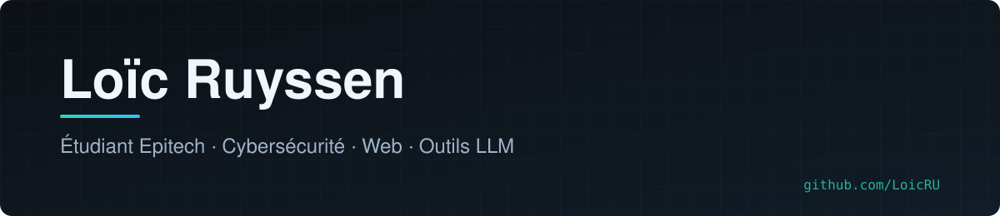
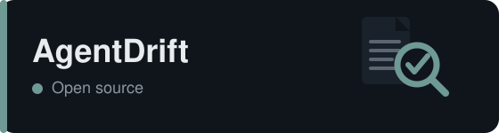
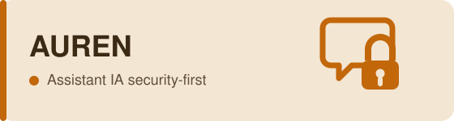
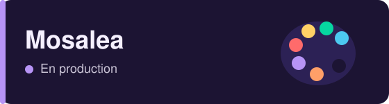
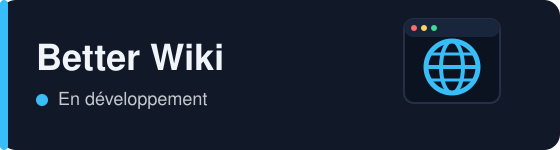

<picture>
  <source media="(prefers-color-scheme: dark)" srcset="assets/banner-dark.svg">
  <source media="(prefers-color-scheme: light)" srcset="assets/banner-light.svg">
  
</picture>

## À propos

Étudiant en 2ᵉ année de Bachelor à **Epitech**. Curieux et créatif, je transforme des idées en projets concrets, avec une préférence pour les solutions qui apportent une vraie valeur.

Je travaille à la croisée de la **cybersécurité**, du **développement web** et des **outils autour des LLM**, et j'aime partager ce que j'apprends.

## Projets

<table>
<tr>
<td width="50%" valign="top">

Linter open source qui vérifie que <code>AGENTS.md</code>, <code>CLAUDE.md</code> et <code>SKILL.md</code> disent la vérité sur le dépôt : commandes, chemins, versions, gestionnaire de paquets.

</td>
<td width="50%" valign="top">

Assistant personnel IA pensé « security-first » : moteur de politiques <em>deny-by-default</em>, coffre à secrets, isolation des prompt injections, mémoire épisodique. Plus de 150 tests automatisés.

 
</td>
</tr>
<tr>
<td width="50%" valign="top">

Plateforme pour artistes et acheteurs, avec paiements via Stripe Connect : l'artiste est payé directement. Développée avec Charlie. <a href="https://mosalea.com">mosalea.com</a> · <a href="https://github.com/LoicRU/mosalea.com">code vitrine</a>

  
</td>
<td width="50%" valign="top">

Extension navigateur qui modernise et personnalise Wikipédia, avec une version gratuite et une version Premium.

</td>
</tr>
</table>

## Stack

**Langages** &nbsp;      

**Web & infra** &nbsp;    

**Outils** &nbsp;   

## Me retrouver

[LinkedIn](https://www.linkedin.com/in/lo%C3%AFc-ruyssen-2002a92b1) · [Mosalea](https://mosalea.com) · [AgentDrift](https://github.com/LoicRU/agentdrift)
