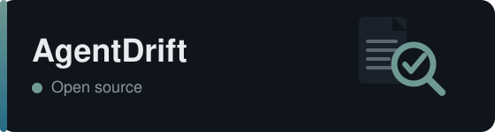
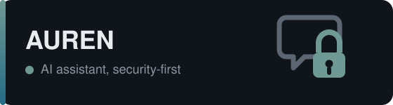
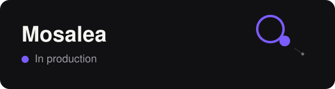
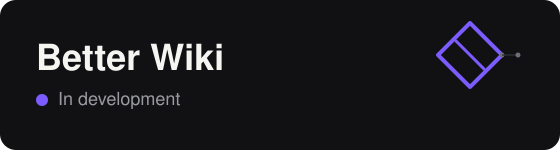

<picture>
  <source media="(prefers-color-scheme: dark)" srcset="assets/banner-dark.svg">
  <source media="(prefers-color-scheme: light)" srcset="assets/banner-light.svg">
  
</picture>

## About

Software Engineering student at **Epitech**, currently in my 2nd year. I work at the intersection of **cybersecurity**, **web development**, and **tooling for LLMs**, and I like turning ideas into things that actually ship.

🔭 Currently: pushing **AgentDrift** toward its first public release.

<picture>
  <source media="(prefers-color-scheme: dark)" srcset="assets/separator-dark.svg">
  <source media="(prefers-color-scheme: light)" srcset="assets/separator-light.svg">
  
</picture>

## Selected work

<table>
<tr>
<td width="50%" valign="top">

Open-source linter that checks whether <code>AGENTS.md</code>, <code>CLAUDE.md</code>, and <code>SKILL.md</code> tell the truth about the repo: commands, paths, versions, package manager.

</td>
<td width="50%" valign="top">

Security-first personal AI assistant: deny-by-default policy engine, secrets vault, prompt-injection isolation, episodic memory. 150+ automated tests.

 
</td>
</tr>
<tr>
<td width="50%" valign="top">

Platform for artists and buyers, with payments via Stripe Connect so artists get paid directly. Built with Charlie. <a href="https://mosalea.com">mosalea.com</a> · <a href="https://github.com/LoicRU/mosalea.com">showcase code</a>

  
</td>
<td width="50%" valign="top">

Browser extension that modernizes and personalizes Wikipedia, with a free tier and a Premium tier.

</td>
</tr>
</table>

<picture>
  <source media="(prefers-color-scheme: dark)" srcset="assets/separator-dark.svg">
  <source media="(prefers-color-scheme: light)" srcset="assets/separator-light.svg">
  
</picture>

## Toolkit

**Languages** &nbsp;      

**Web & infra** &nbsp;    

**Tools** &nbsp;   

<picture>
  <source media="(prefers-color-scheme: dark)" srcset="assets/separator-dark.svg">
  <source media="(prefers-color-scheme: light)" srcset="assets/separator-light.svg">
  
</picture>

## Activity

<table>
<tr>
<td width="55%" valign="top">

</td>
<td width="45%" valign="top">

</td>
</tr>
</table>

Auto-generated weekly via <a href="https://github.com/lowlighter/metrics">lowlighter/metrics</a>.

<picture>
  <source media="(prefers-color-scheme: dark)" srcset="assets/separator-dark.svg">
  <source media="(prefers-color-scheme: light)" srcset="assets/separator-light.svg">
  
</picture>

## Elsewhere

[LinkedIn](https://www.linkedin.com/in/lo%C3%AFc-ruyssen-2002a92b1) · [Mosalea](https://mosalea.com) · [AgentDrift](https://github.com/LoicRU/agentdrift)

LoicRU · Loïc Ruyssen
