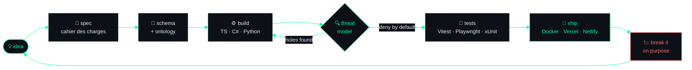

<!--
  ╔══════════════════════════════════════════════════════════════════╗
  ║  LoicRU / LoicRU  ·  profile README                              ║
  ║  build. break. learn. repeat.                                    ║
  ║                                                                  ║
  ║  Tu lis le code source d'un README. Bon réflexe. 🫡              ║
  ║  Le header est un SVG animé écrit à la main : ./assets/terminal.svg
  ╚══════════════════════════════════════════════════════════════════╝
-->

<div align="center">
  
</div>

<div align="center">

<a href="https://www.linkedin.com/in/lo%C3%AFc-ruyssen-2002a92b1/">
  
</a>
<a href="https://mosalea.com">
  
</a>
<a href="mailto:loic.ruyssen@gmail.com">
  
</a>


<br><br>

<a href="https://git.io/typing-svg">
  
</a>

</div>


## `$ whoami`

```yaml
identity:
  name:      Loïc Ruyssen
  handle:    LoicRU
  location:  France
  studies:   Epitech
  motto:     "build. break. learn. repeat."

focus:
  primary:   cybersecurity        # policy engines, threat modeling, post-quantum crypto
  secondary: full-stack           # Next.js · TypeScript · Supabase · Docker
  playground: LLM tooling         # Claude / GPT / Groq APIs, agents, automation

philosophy:
  - "A project that ships teaches more than a project that is planned."
  - "Read the source. Then read it again, adversarially."
  - "Deny by default — in code and in architecture."

status:
  open_to:   ["cybersecurity internship", "interesting problems", "coffee"]
  currently: "turning specs into products, and products into lessons"
```


## `$ cat ~/.stack`

<div align="center">

**Languages**


**Frameworks & Runtime**


**Data & Infrastructure**


**Tooling & Craft**


</div>

<details>
<summary><b><code>$ tree ~/.stack --deep</code></b> — the honest breakdown</summary>

<br>

| Layer | What I actually use | Confidence |
| :--- | :--- | :--- |
| **Frontend** | Next.js 15/16, React 19, TypeScript 5.x, Tailwind v4, Zustand | `████████░░` daily |
| **Backend** | Node/TS API routes, C# / .NET 8, Python, PHP | `███████░░░` solid |
| **Data** | PostgreSQL 15+, Supabase (RLS, pooler), SQL schema design | `███████░░░` solid |
| **Security** | Threat modeling, deny-by-default policy engines, prompt-injection isolation, secrets vaults, PQC (Kyber / Dilithium) | `██████░░░░` growing fast |
| **Testing** | Vitest, Playwright, xUnit — 150+ automated tests on my main .NET project | `███████░░░` non-negotiable |
| **DevOps** | Docker, GitHub Actions, Netlify / Vercel deploys, env & secret hygiene | `██████░░░░` shipping-grade |
| **AI plumbing** | Claude / GPT / Groq APIs, agentic workflows, n8n & Make automations | `████████░░` daily |
| **Visual** | Blender, GIMP, Figma — because a product people won't look at doesn't exist | `█████░░░░░` enough |

</details>


## `$ ls -la ~/projects`

<div align="center">

### ⬢ Mosalea — *the one that pays rent*

<a href="https://mosalea.com">
  
</a>


<sub>A real product with real users — marketplace for human-made art, built, shipped, marketed and legally declared solo.<br>
Everything else on this profile is training. This one is the exam. → <a href="https://mosalea.com"><b>mosalea.com</b></a></sub>

<br><br>

<a href="https://github.com/LoicRU/investment-bot-render">
  
</a>
<a href="https://github.com/LoicRU/learning_Discord-bot">
  
</a>
<a href="https://github.com/LoicRU/learning_extensions">
  
</a>
<a href="https://github.com/LoicRU?tab=repositories">
  
</a>

</div>

> **`investment-bot-render`** — a Python trading/investment bot deployed on Render: market data in, strategy logic in the middle, decisions out. My sandbox for automation under real-world constraints (rate limits, uptime, and the humbling fact that markets do not care about your backtest).


## `$ ./pipeline --explain`

How an idea becomes something that runs — the loop I actually follow:




## `$ git log --stat --author="LoicRU"`

<div align="center">


<br>


<br><br>


</div>


## `$ sudo ./snake --eat-contributions`

<div align="center">

<picture>
  <source media="(prefers-color-scheme: dark)" srcset="https://raw.githubusercontent.com/LoicRU/LoicRU/output/snake-dark.svg">
  <source media="(prefers-color-scheme: light)" srcset="https://raw.githubusercontent.com/LoicRU/LoicRU/output/snake-light.svg">
  
</picture>

<sub>🐍 regenerated every 12h by GitHub Actions — it eats what I commit</sub>

<br><br>


<sub>🧊 isometric build of my contribution year, rebuilt nightly</sub>

</div>


## `$ ./achievements --list`

<div align="center">


</div>


## `$ tail -f ~/now.log`

```console
[2026] ▸ Epitech — algorithms, OOP (Java), systems, and the good kind of sleep deprivation
[2026] ▸ Hunting a cybersecurity internship — AUREN (C#/.NET 8) as the centerpiece:
         deny-by-default policy engine · secrets vault · prompt-injection isolation · 150+ tests
[2026] ▸ Shipping and growing Mosalea — product, marketing and legal, solo
[2026] ▸ Digging into post-quantum cryptography (CRYSTALS-Kyber, CRYSTALS-Dilithium)
[2026] ▸ Building small games and tools because that is still the fastest way to learn
[    ] ▸ _
```

<div align="center">


</div>

<!--
  ══ MODULES OPTIONNELS (voir SETUP.md) ═══════════════════════════════

  ① WakaTime — temps de code réel par langage, mis à jour tout seul.
     Compte sur wakatime.com + plugin dans ton IDE, puis colle :

  

  ② Metrics (lowlighter) — nécessite le workflow metrics.yml + le secret
     METRICS_TOKEN. Une fois le workflow lancé une première fois, colle :

  <div align="center">
    
    
    
  </div>

  ③ Spotify now-playing — novatorem (fork + déploiement Vercel), puis :

  

  ═════════════════════════════════════════════════════════════════════
-->


## `$ man loic`

<div align="center">

| | |
| :--- | :--- |
| **NAME** | `loic` — student, builder, professional breaker of his own code |
| **SYNOPSIS** | `loic [--build] [--break] [--learn] [--repeat]` |
| **DESCRIPTION** | Turns ideas into shipped software. Prefers a working v1 today over a perfect v3 that never exists. Reads specs adversarially. |
| **OPTIONS** | `--internship` open for cybersecurity · `--collab` always · `--sleep` deprecated |
| **BUGS** | Starts more projects than any human can finish. Working on it. Kind of. |
| **SEE ALSO** | [`mosalea.com`](https://mosalea.com) · [`linkedin`](https://www.linkedin.com/in/lo%C3%AFc-ruyssen-2002a92b1/) |

</div>

<details>
<summary><b><code>$ sudo rm -rf /</code></b></summary>

<br>

```console
[sudo] password for loic: ********
Permission denied.

Nice try. This profile is deny-by-default. 🛡️

Since you're here anyway — three things I believe:
  1. Security is a design decision, not a checklist you run at the end.
  2. If you can't explain your architecture in one diagram, you don't have one.
  3. The best way to understand a system is to try to break it. Politely.

$ exit
```

</details>

<div align="center">
  
</div>
